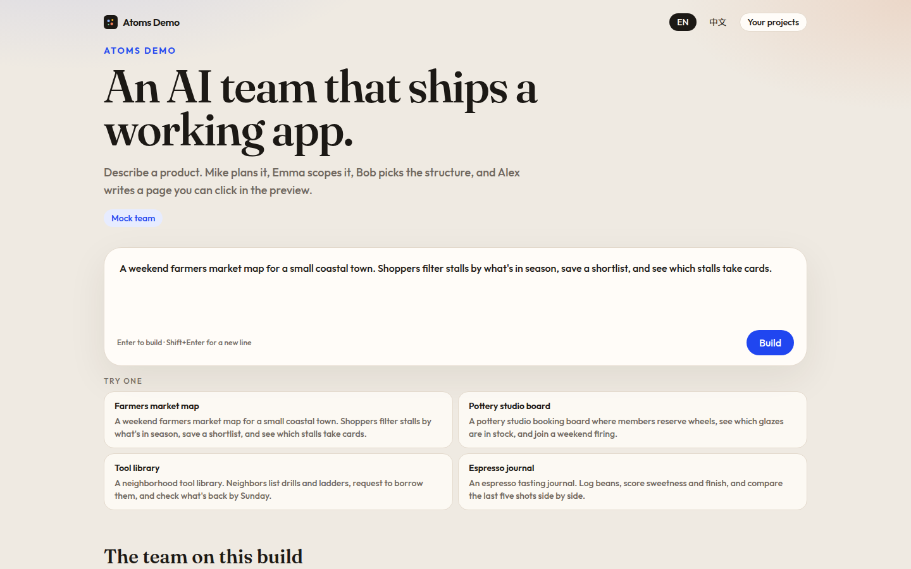
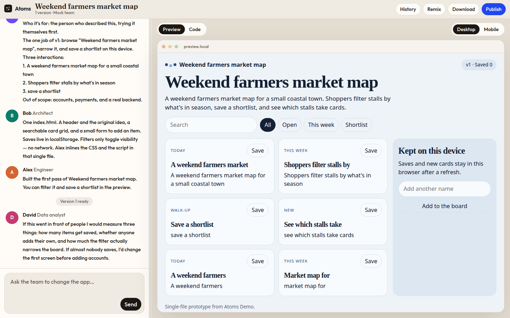
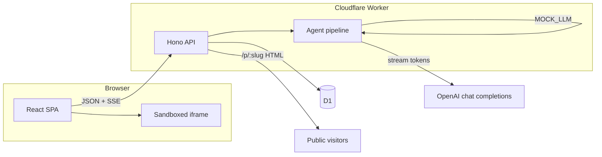
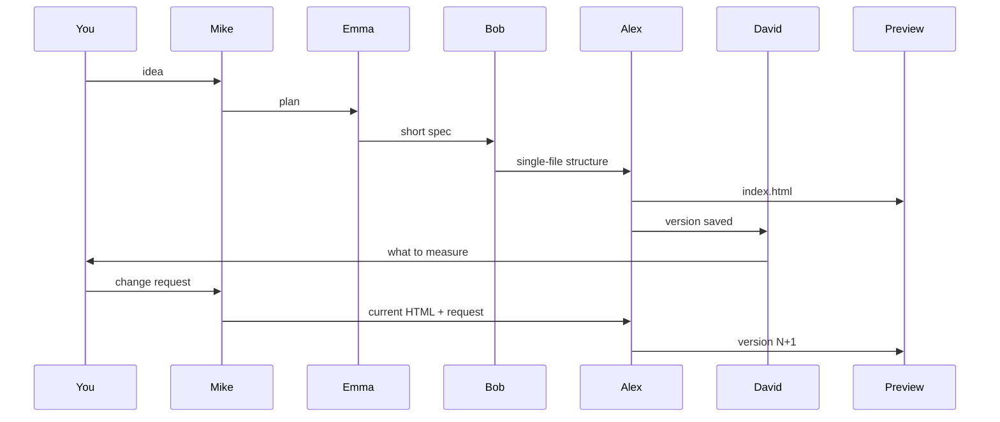

# Atoms Demo

Atoms Demo is a small AI product team you can run in the browser. You describe an app in a sentence. Mike (team lead), Emma (product manager), Bob (architect), and Alex (engineer) work through it in chat, and a live preview appears on the right. David (data analyst) closes the first build with what to measure. A follow-up message edits the same app and saves a new version.

It is a take-home recreation of the core loop on [atoms.dev](https://atoms.dev/): a multi-agent build, a preview beside the chat, and a one-click published URL. There is no account. Projects belong to an anonymous id stored in this browser.





## Architecture



The Worker serves the API and published pages. Static assets (the Vite build) serve the SPA, including client routes like `/project/:id`, via `not_found_handling: single-page-application`. `run_worker_first` sends `/api/*` and `/p/*` to the Worker before assets.



Follow-ups skip Emma, Bob, and David. Mike restates the change, then Alex rewrites the full `index.html` with the current source in the prompt. Every successful Alex pass is a new row in `versions`.

## What the model actually does

Each persona is a streamed chat completion (`stream: true`) against `POST {OPENAI_BASE_URL}/chat/completions`. The default model is `gpt-4.1` (`OPENAI_MODEL`). Tokens are forwarded to the browser as Server-Sent Events and appended to that agent's message.

Alex is asked to reply with a one-line `NOTE:` and then a single `html` fence. The Worker splits that stream: the note stays in chat, the document streams into the Code tab, and the iframe updates once a complete document is present. The stored version is the extracted document only.

If `MOCK_LLM=true` (or `1` / `yes` / `on`), the same SSE events fire, but the lines come from a local generator instead of OpenAI. The UI, database, versions, and publish path are unchanged. Use this when you do not have a key. There is no silent fallback: with the flag off and no key, the run stops with an error in the chat.

## Features

- Landing page with example prompts, English / 中文 copy, and this browser's project list
- Streaming multi-agent build and a resizable chat / preview split
- Sandboxed iframe preview (`allow-scripts`, no same origin) and a Code tab with syntax highlighting for `index.html`
- Desktop / mobile preview frame
- Follow-up edits create a new version, with the previous HTML sent as context
- Version history: open an older build, or restore it as current
- Publish to `/p/:slug` (public, full screen). Publish again to point the same link at the latest version. Unpublish clears it.
- Remix (duplicate chat, versions, and current preview into a new project)
- Download the current or viewed `index.html`
- Anonymous owner via an `atoms_uid` cookie, with `localStorage` as a backup header
- Stop button aborts the model request

## Local development

Requirements: Node 22+, npm.

```bash
npm install
cp .dev.vars.example .dev.vars
```

Edit `.dev.vars`:

- Real model: set `OPENAI_API_KEY` and leave `MOCK_LLM=false`
- No key: set `MOCK_LLM=true`

Then:

```bash
npm run dev
```

That typechecks, builds the SPA, applies D1 migrations to the local database, and starts `wrangler dev` on port 8787. Local D1 lives in `.wrangler/state`. Open http://127.0.0.1:8787.

`npm run dev:mock` forces the mock team even if `.dev.vars` is missing.

Other scripts:

```bash
npm test          # parser, HTML extraction, mock app
npm run build     # typecheck + vite build
npm run preview   # wrangler dev without rebuilding
```

## Deploy

The `database_id` in `wrangler.jsonc` is a **placeholder** (`00000000-0000-0000-0000-000000000000`). Replace it before the first remote deploy.

```bash
npx wrangler login
npx wrangler d1 create atoms-demo
# Paste the printed database_id into wrangler.jsonc (binding DB, database_name atoms-demo)

npm run build
npx wrangler d1 migrations apply atoms-demo --remote
npx wrangler secret put OPENAI_API_KEY
npx wrangler deploy
```

Optional secrets / vars (vars already have defaults in `wrangler.jsonc`):

| Name | Role |
| --- | --- |
| `OPENAI_API_KEY` | Secret. Required unless `MOCK_LLM=true`. |
| `OPENAI_MODEL` | Default `gpt-4.1`. |
| `OPENAI_BASE_URL` | Default `https://api.openai.com/v1`. An OpenAI-compatible root, not the full `/chat/completions` path. |
| `MOCK_LLM` | `true` to skip the provider. Do not enable this on a public deployment unless you mean to. |
| `MOCK_DELAY_MS` | Pause between mock chunks. `0` is instant. |

`npx wrangler deploy` uploads the Worker and the `dist/` assets from the last `npm run build`. Run the build first (or `npm run deploy`, which does both).

## Data model

`migrations/0001_init.sql`

- `projects` — owner, idea, status, current version, published slug
- `messages` — user, agent, and system lines
- `versions` — every generated `index.html`, numbered per project

The Worker also applies that SQL on startup (`CREATE IF NOT EXISTS`), so a local `wrangler dev` still boots if you skipped the migrate command. Remote databases should still get `wrangler d1 migrations apply --remote` so the migrations table stays honest.

## How this was built

This repo was implemented with Cursor's coding agent (Grok) as a pair: product shape from atoms.dev and the public agent docs, then the Worker, D1 schema, streaming pipeline, and UI in this workspace. The agent pipeline prompts, the mock team, and the browser pass over the running app were part of that session. Generated apps in the preview are model output (or the mock generator), not hand-written pages checked in as the product.

## Known gaps

- Generated apps are one self-contained frontend file. They do not get a backend, auth, or a database of their own.
- A run lives on the request. Closing the tab stops it. Another tab sees "already working" until the lock goes stale (about three minutes) or you take over.
- Publishing serves the version you published. Restoring an older version locally does not change the public URL until you publish again.
- No GitHub export, visual editor, or multi-model race.
- The mock team follows the idea and can apply a dark theme, a color, and a revision panel. It is not a general code model. Use a real `OPENAI_API_KEY` for open-ended edits.
- `npm run dev` rebuilds the SPA before starting Wrangler, so the first start is a full build rather than Vite HMR.
