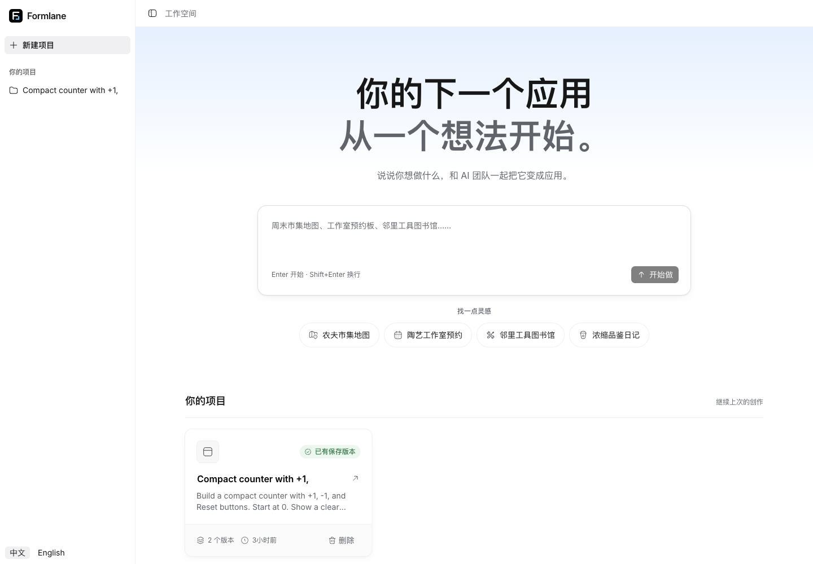
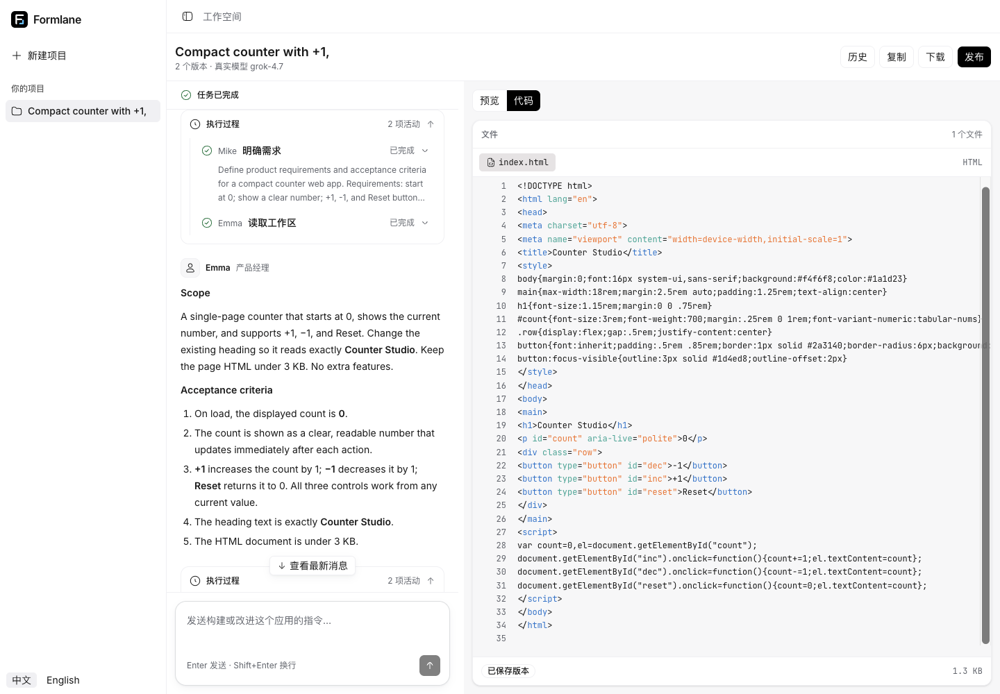
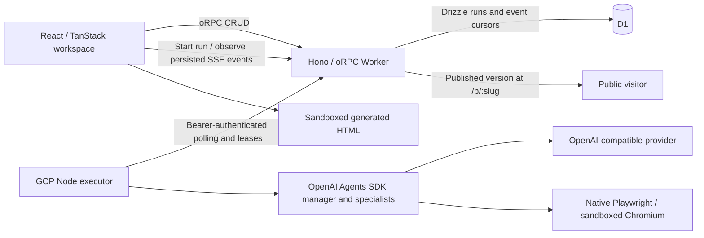

# Formlane

Describe an app in a sentence and watch an AI product team build it. Mike uses OpenAI Agents SDK manager decision tools to delegate scoped work: Emma defines requirements, Bob designs the structure, Alex implements and repairs the HTML app, and David independently validates it. Follow-ups preserve the current app and use the same validation gate.

This is a recreation of the core [atoms.dev](https://atoms.dev/) loop: team conversation, interactive preview, and a published link. There is no registered account system. Projects belong to an anonymous browser identity.

Try the [live workspace](https://formlane-9dp.pages.dev) or the [published market example](https://formlane-9dp.pages.dev/p/7e2g3qqnnd).




The screenshots show the redesigned interface using a persisted real-provider counter project. See the [mobile homepage](docs/screenshots/home-redesign-mobile.png), [mobile source view](docs/screenshots/code-redesign-mobile.png), and [published market example](docs/screenshots/real-market-desktop.png).

## Features

- English/Chinese interface, example prompts, and this browser's project list.
- assistant-ui conversations, streaming Markdown, grouped execution traces, actual delegation tasks, per-tool outcomes, review summaries, and runtime-owned prompt composers.
- Resizable conversation/preview workspace on desktop; full-height conversation and preview switching on mobile.
- Sandboxed interactive preview, a syntax-highlighted `index.html` source view with live draft streaming, and desktop/mobile preview sizes.
- Follow-up revisions with the current HTML in context.
- Version history, historical preview, and restoring a saved result as current.
- Publish a saved result at `/p/:slug`, republish the same link, or unpublish it.
- Remix a project with its conversation and versions; download generated `index.html`.
- Cancel a durable run without replacing the last complete result; disconnect and reconnect without cancelling execution.

## Source architecture

The repository adopts the engineering and Skyline design baseline of the read-only reference at `/Users/qiqian/Projects/Qlj/adcounter`, while retaining the Atoms product and D1 persistence. The working project is `/Users/qiqian/Projects/Self/atoms-demo`.

| Workspace                                  | Responsibility                                                                                       |
| ------------------------------------------ | ---------------------------------------------------------------------------------------------------- |
| `apps/web`                                 | React/Vite, TanStack Router and Query, assistant-ui external runtimes, Zod, project orchestration    |
| `apps/server`                              | Hono control-plane Worker, oRPC contracts, D1 runs/events/checkpoints, executor lease API            |
| `apps/executor`                            | Node 24, OpenAI Agents SDK manager/specialists, native Playwright, remote checkpoint recovery on GCP |
| `packages/contracts`                       | Shared oRPC/Zod contract consumed by the server and typed web client                                 |
| `packages/atoms-core` (`@atoms-demo/core`) | Runtime-independent types, HTML/text parsing, and prompts                                            |
| `packages/ui`                              | assistant-ui conversation composites, shadcn base-nova / Base UI controls, Hugeicons, Skyline tokens |
| `packages/i18n`                            | The single English/Chinese message catalog and locale helpers                                        |



The contract is imported from `@atoms-demo/contracts`, not inferred by importing server code. CRUD uses the typed oRPC client; SSE observes persisted run events rather than owning model execution. Shared packages do not depend on applications. See [architecture](docs/internals/architecture.md) and [ADR-0012](docs/adr/0012-durable-agent-harness.md).

The assistant-ui external runtime observes existing persisted messages and SSE events; it does not start a second agent backend. Tool invocations are paired by run and sequence, replayed events are deduplicated, and missing results remain unfinished after cancellation or failure. Completed structured agent output uses expandable data parts. Homepage suggestions, prompt drafts, send/stop controls, message rendering, and viewport scrolling use assistant-ui; the original D1 ownership and saved-version rules remain authoritative.

## Durable, real-provider execution

OpenAI Agents SDK 0.21 runs the configured compatible Chat Completions model in the Node 24 executor on GCP. Mike's schema-validated delegation decision and each specialist's tool loop have separate immutable D1 checkpoints. Specialists have role-scoped tools: Alex can read, write, precisely edit, update acceptance checks and validate; David can read, update checks, validate and record review; planning agents can read. HTML edits preserve checks and invalidate prior validation/review. Browser failures return concrete evidence for repair, not a successful saved version.

Completion requires a passing real-browser report for the current artifact hash and David's explicit acceptance. Native Playwright validates an opaque iframe in fresh browser contexts, with restrictive CSP and HTTP/WebSocket traffic blocked. Chromium runs sandboxed with a credential-stripped environment. Declarative checks support click/fill/press/reload, text containment, exact value/count/attribute assertions and viewport overflow checks, not arbitrary model JavaScript in the privileged executor.

D1 stores runs, sequence-addressed events, leases and checkpoints. The VM polls the bearer-authenticated control plane, holds a 60-second lease and heartbeats every 10 seconds. Reconnect replays browser events after the last cursor; closing a tab only closes observation. Each run has a persisted **15-minute deadline**. Cancellation fences writes; the executor aborts when its heartbeat loses authority. Expired leases can be reclaimed and saved checkpoints replayed after restart. Timeout, provider failure, validation failure and cancellation remain distinct; none replaces the prior complete version. In-flight model/tool calls may repeat, so provider billing is not exactly-once.

Generation is real-only. A missing `OPENAI_API_KEY` fails visibly; there is no mock mode or fallback.

## Development

Use the Node and pnpm versions pinned in the root manifest; this is a **pnpm + Turbo monorepo**, not an npm single-package application. Remote changes require explicit authorization.

```sh
pnpm install
cp apps/server/.dev.vars.example apps/server/.dev.vars
pnpm db:migrate
pnpm dev
```

The Vite UI uses the Worker API; `pnpm dev:web` and `pnpm dev:server` run them separately. The Worker owns D1 and `EXECUTOR_TOKEN`; model execution requires the separate executor, native Chromium and an HTTPS control-plane URL. Local UI startup alone does not prove end-to-end generation. See [development](docs/operations/development.md) for environment boundaries.

| Executor variable   | Meaning                                                 |
| ------------------- | ------------------------------------------------------- |
| `OPENAI_API_KEY`    | Required real-provider secret, held by the executor     |
| `ENDPOINT`          | OpenAI-compatible API root                              |
| `MODEL`             | Provider model name                                     |
| `EXECUTOR_TOKEN`    | Shared bearer secret matching the API control plane     |
| `CONTROL_PLANE_URL` | HTTPS API origin used for `/internal/executor` requests |

Use focused tests and package typechecks while developing; one integration owner coordinates full checks. See [development](docs/operations/development.md), [testing](docs/internals/testing.md), and [debugging](docs/operations/debugging.md).

Current real-provider acceptance passed with Grok run/version `a89ff0f4-d116-4e85-80e0-b22de6a46412` in 629 seconds. Alex's eight browser checks and David's seven independent checks passed before saving. Hands-on production verification covered category filtering, detail/card data, synchronized favorites, empty intersections, Enter/Space activation, 375px layout, in-memory reset, saved-version reload, download integrity and anonymous publication. [CI](https://github.com/Muluk-m/formlane/actions/runs/43002293994) passed lint, typechecks, tests and builds. Browser response fixtures also verified that stale project errors cannot override the current run while actual run failures remain visible. See [deployment evidence](docs/operations/deployment.md) for run IDs and limits. Earlier runs exercised reconnect and cancellation; process-crash recovery is covered by lease/checkpoint invariants, not claimed as a live crash experiment.

## Deployment status

Live site: **https://formlane-9dp.pages.dev**. Deployed to the verified **Maqiqian0316@gmail.com's Account** (`252fba810f75c0370e5aa7200abc8f80`) using Pages `formlane`, service-bound Worker `formlane-api`, and the existing project D1 database. The Formlane logo, homepage, same-origin API, and database-backed project listing were verified online.

Agent compute runs on the user-approved GCP VM `formlane-agent`, with Node 24 and native Playwright under non-root systemd. The configured model is `grok-4.7` at `https://sub2api.qiliangjia.org/v1`; its key is in the root-owned mode-600 executor environment file, not frontend code. The requested `grok-build-4.7` name was unavailable; the provider's registered 4.7 model passed SDK probes and the market-app acceptance above. The Cloudflare Free CPU limit killed the earlier validator implementation, so Workflows/browser bindings were superseded without a billing upgrade. See [deployment](docs/operations/deployment.md) for accounts, cost approval, secret handling and evidence boundaries.

## Limits and behavior worth knowing

- Generated apps are self-contained frontend HTML, not provisioned backends, authentication systems, or databases.
- Real-provider latency remains significant: the verified market build took 10 minutes 29 seconds. Runs exceeding the 15-minute deadline fail without replacing the previous saved version.
- Project data and saved HTML persist in D1; generated-app interactive state does not. Generated apps use in-memory state inside the opaque-origin preview rather than relying on browser storage.
- D1 checkpoints resume durable orchestration, not an interrupted provider token stream. In-flight specialist calls may replay after lease reclaim or a crash.
- Historical preview, current version, and published version are distinct. Restoring changes the current result, not the public link; publish again to update that link.
- Anonymous identity is a demo ownership boundary, not a substitute for production authentication.
- No GitHub export, visual editor, or multi-model race is claimed.

[Documentation index](docs/README.md) · [Product terminology](CONTEXT.md) · [Full design system](DESIGN.md) · [Agent entry point](AGENTS.md)
