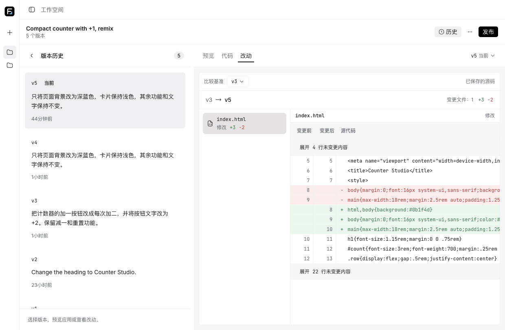

# Formlane

Describe an app and watch an AI product team build it. Mike delegates to Emma for requirements, Bob for template selection, Alex for implementation and David for independent validation. Follow-ups revise the current source and repeat the acceptance gate. This recreates the core [atoms.dev](https://atoms.dev/) loop: team conversation, interactive preview and a published link. Projects belong to an anonymous browser identity; there is no registered account system.

The replacement architecture is **FastAPI + native CrewAI + PostgreSQL on the existing GCP VM**, with **static React on Cloudflare Pages** and an isolated Node compiler. The API at **https://136.65.182.87** is currently staged. **Final production cutover has not happened**; staging rehearsal and earlier release evidence are not production acceptance. [Deployment status and cutover](docs/operations/deployment.md) record the gate and remaining evidence.

The frontend stays at [formlane-9dp.pages.dev](https://formlane-9dp.pages.dev), preserving existing anonymous browser ownership and shared links. Historical published examples include the [React counter](https://formlane-9dp.pages.dev/p/8tq3mrv54j) and [market app](https://formlane-9dp.pages.dev/p/7e2g3qqnnd).

These screenshots document earlier deployed product behavior, not acceptance of the Python cutover.

## Features

- English/Chinese interface, example prompts and this browser's project list.
- assistant-ui conversations with streaming Markdown, delegation tasks, grouped tool outcomes, review summaries and persistent prompt drafts.
- Resizable desktop workspace and full-height mobile conversation/preview switching.
- Sandboxed interactive preview, desktop/mobile sizes, selectable source files, live unsaved drafts and build results.
- Demand-selected Vanilla + Vite or React + TypeScript + Vite source projects; follow-ups preserve accepted behavior outside the requested change.
- Version history, current/published markers, historical preview, selectable source comparisons, confirmed restore and ancestry-based Undo.
- Publish, republish or unpublish a saved version at a stable link; remix a selected version and download complete runnable source.
- Durable generation: tab closure does not cancel; reconnect replays events; explicit cancel preserves the last complete version.

## Architecture

| Workspace                      | Responsibility                                                                                           |
| ------------------------------ | -------------------------------------------------------------------------------------------------------- |
| `apps/web`                     | React/Vite, TanStack Router/Query, assistant-ui and direct typed API transport                           |
| `apps/backend`                 | FastAPI, PostgreSQL/SQLAlchemy, explicit Alembic migrations, durable native CrewAI worker and Playwright |
| `apps/compiler`                | Isolated trusted Node compiler for virtual source and fixed template dependencies                        |
| `packages/contracts`           | Shared oRPC/Zod wire contract consumed by the typed frontend and preserved by Python                     |
| `packages/atoms-core`          | Runtime-independent TypeScript types, templates, source validation/hashing and helpers                   |
| `packages/ui`, `packages/i18n` | Base UI/Hugeicons/Skyline controls, assistant-ui composites and the single bilingual catalog             |

The API and worker share PostgreSQL's six business tables: projects, messages, versions, runs, run_events and run_checkpoints. Pages has no business Functions, Worker binding or database. The worker claims fenced leases and checkpoints native CrewAI work; SSE observes persisted events. Node owns no business endpoints or orchestration. See [architecture](docs/internals/architecture.md), [data model](docs/internals/data-model.md) and [ADRs](docs/adr/README.md).

A saved version requires a build for the current source, passing implementation checks, independent browser validation and David's explicit acceptance. Source/check changes invalidate affected evidence. Sandboxed Chromium validates opaque iframes with restricted networking and no provider/database credentials. Compiler subprocesses accept bounded virtual source without executing generated package scripts or plugins.

Runs have a persisted **15-minute deadline**, a 60-second lease and a 10-second heartbeat. Cancellation fences late writes. Expired work can be reclaimed and completed checkpoints reused, but interrupted provider calls may repeat; billing is not exactly-once. Failures retain previous current and published versions.

## Development

Use the manifest-pinned Node/pnpm versions and Python 3.13 with uv. PostgreSQL is required; use a dedicated local database and explicit migrations. Provider credentials stay in private backend environment files.

`pnpm dev` starts only the web frontend. `pnpm dev:api` starts FastAPI, `pnpm dev:worker` builds the compiler and starts the durable Python worker, and `pnpm db:migrate` applies Alembic. See [development](docs/operations/development.md) for setup, CORS, origin configuration and separate process commands; [testing](docs/internals/testing.md) describes authorized focused verification.

## Deployment and limitations

The target API uses the reserved GCP address `formlane-api` in `us-central1` on the existing `formlane-agent` VM. Caddy terminates HTTPS on 443 and proxies to loopback FastAPI; PostgreSQL is loopback-only. Production remains gated on real-model acceptance and a final write-fenced six-table import. The provider remains `grok-4.7` at the existing compatible endpoint; secrets never enter frontend configuration. Exact accounts, service paths, staging databases and recovery rules are in [deployment](docs/operations/deployment.md).

Generated projects are frontend applications with fixed template dependencies, bounded to 64 files/256 KiB of source and 512 KiB of compiled preview. The service does not provision generated backends, databases or authentication. Interactive state is in memory inside the opaque preview; saved source/history does not persist generated runtime state. Downloaded projects run with `pnpm install`, `pnpm dev` and `pnpm build`; React projects also support `pnpm typecheck`. The compiler supports local JS/TS/JSX/TSX, CSS, JSON and SVG with fixed React imports, not arbitrary server modules or custom Vite plugins.

Anonymous identity is a demo ownership boundary. Current, viewed and published versions remain distinct; restoring or undoing does not republish. Real-model latency can be substantial, and deadline failures preserve prior results. No GitHub export, visual editor or multi-model race is claimed.

[Documentation](docs/README.md) · [Terminology](CONTEXT.md) · [Design system](DESIGN.md) · [Agent guidance](AGENTS.md)
