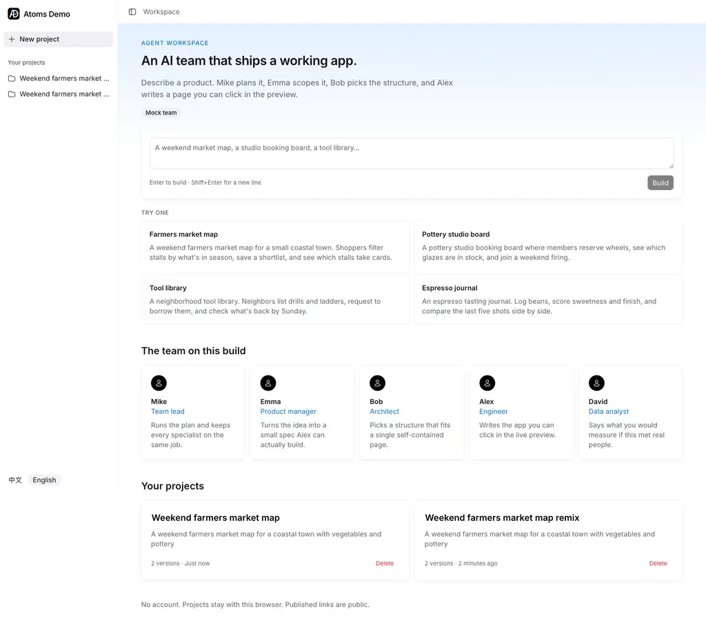
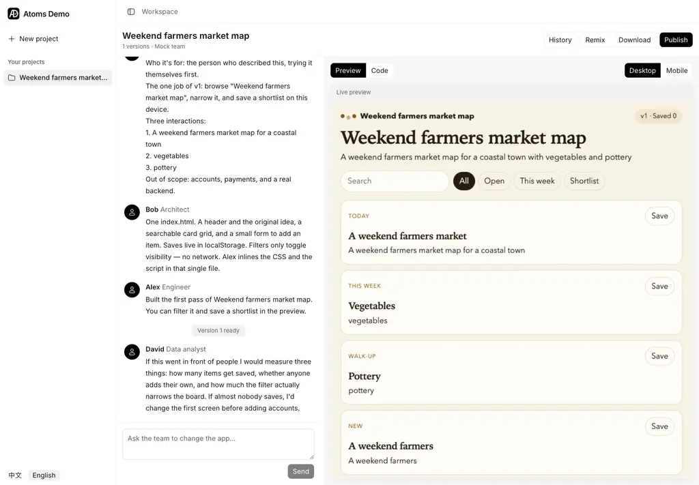
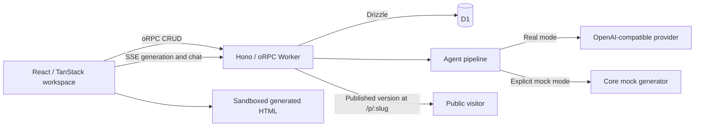

# Formlane

Describe an app in a sentence and watch a small AI product team build it. Mike leads, Emma writes the product brief, Bob chooses the structure, Alex generates a single HTML app, and David suggests what to measure. A follow-up asks Mike and Alex to revise the current app and save another version.

This is a recreation of the core [atoms.dev](https://atoms.dev/) loop: team conversation, interactive preview, and a published link. There is no registered account system. Projects belong to an anonymous browser identity.




Captured from the migrated local workspace in explicit mock mode.

## Features

- English/Chinese interface, example prompts, and this browser's project list.
- Streaming agent conversation beside a resizable preview/code workspace.
- Sandboxed interactive preview, syntax-highlighted HTML, desktop/mobile preview sizes.
- Follow-up revisions with the current HTML in context.
- Version history, historical preview, and restoring a saved result as current.
- Publish a saved result at `/p/:slug`, republish the same link, or unpublish it.
- Remix a project with its conversation and versions; download generated `index.html`.
- Stop an active generation request without replacing the last complete result.

## Source architecture

The repository adopts the engineering and Skyline design baseline of the read-only reference at `/Users/qiqian/Projects/Qlj/adcounter`, while retaining the Atoms product and D1 persistence. The working project is `/Users/qiqian/Projects/Self/atoms-demo`.

| Workspace                                  | Responsibility                                                                                                    |
| ------------------------------------------ | ----------------------------------------------------------------------------------------------------------------- |
| `apps/web`                                 | React/Vite, TanStack Router and Query, React Hook Form/Zod, project and generation UI                             |
| `apps/server`                              | Hono Worker, oRPC contract implementation, SSE orchestration, Drizzle D1 persistence, publication/download routes |
| `packages/contracts`                       | Shared oRPC/Zod contract consumed by the server and typed web client                                              |
| `packages/atoms-core` (`@atoms-demo/core`) | Runtime-independent types, HTML/text parsing, prompts, mock generator                                             |
| `packages/ui`                              | Shared shadcn base-nova / Base UI primitives and composites, Hugeicons, Skyline tokens                            |
| `packages/i18n`                            | The single English/Chinese message catalog and locale helpers                                                     |



The contract is imported from `@atoms-demo/contracts`, not inferred by importing server code. CRUD uses the typed oRPC client with OpenAPILink and TanStack Query helpers; generation remains SSE so streaming/cancellation semantics stay intact. Shared packages do not depend on applications. See [architecture](docs/internals/architecture.md) and [D1 decision](docs/adr/0010-server-on-workers.md).

## Real model versus mock mode

**Real mode** calls `POST {OPENAI_BASE_URL}/chat/completions` with streaming enabled. `OPENAI_MODEL` selects the model. Alex emits a short `NOTE:` and an HTML document; the parser separates conversation from code, and only a complete document becomes a saved version.

**Mock mode** is explicit and local-only: `MOCK_LLM=true` with `ENVIRONMENT=local` uses the local generator instead of a provider. It exercises the same conversation stream, database, version, preview, and publication path. The generator supports bounded template/theme/revision behavior; it is not an open-ended coding model. A successful mock run does not verify provider credentials or live generation quality. Non-local environments reject mock mode.

With mock mode off, a missing `OPENAI_API_KEY` is an error. There is no silent provider-to-mock fallback. Stop aborts the active request; generation is request-bound rather than a durable background workflow.

## Development

Use the Node and pnpm versions pinned in the root manifest; this is a **pnpm + Turbo monorepo**, not an npm single-package application. Setup and all secrets are local until an authorized deployment is explicitly requested.

```sh
pnpm install
cp apps/server/.dev.vars.example apps/server/.dev.vars
pnpm db:migrate
pnpm dev
```

Set `MOCK_LLM=true` and `ENVIRONMENT=local` in `apps/server/.dev.vars` for local work without a provider key. For real mode, set `OPENAI_API_KEY` and leave `MOCK_LLM=false`. Wrangler reads local variables from the server workspace. The Vite UI uses the local Worker API; `pnpm dev:web` and `pnpm dev:server` can run them separately. Consult the manifests for current ports and command implementations.

| Variable          | Meaning                                                  |
| ----------------- | -------------------------------------------------------- |
| `OPENAI_API_KEY`  | Secret required for real mode                            |
| `OPENAI_BASE_URL` | OpenAI-compatible API root, not the full completions URL |
| `OPENAI_MODEL`    | Provider model name                                      |
| `MOCK_LLM`        | Explicitly choose the local-only generator               |
| `ENVIRONMENT`     | Must be `local` when mock mode is enabled                |
| `MOCK_DELAY_MS`   | Delay between mock chunks; zero makes them immediate     |

Use focused tests and package typechecks while developing; one integration owner coordinates full checks. See [development](docs/operations/development.md), [testing](docs/internals/testing.md), and [debugging](docs/operations/debugging.md).

Migration verification: remote Biome checks, six package typechecks, 24 tests, Vite production build, and Worker dry-run passed. Local browser checks exercised generation, preview Save/Add, follow-up revisions, reload persistence, version restore, publication/unpublication, HTML download, code/mobile views, and remix in explicit mock mode. Production real-model generation and generated-app interaction were subsequently verified online.

## Deployment status

Live site: **https://formlane-9dp.pages.dev**. Deployed to the verified **Maqiqian0316@gmail.com's Account** (`252fba810f75c0370e5aa7200abc8f80`) using Pages `formlane`, service-bound Worker `formlane-api`, and the existing project D1 database. The Formlane logo, homepage, same-origin API, and database-backed project listing were verified online.

Production uses `gpt-6.1-sol` at `https://sub2api.qiliangjia.org/v1`, with its key stored only as a Cloudflare Secret. Health reports `hasKey: true`, `mock: false`. A real counter app was generated, its plus button changed 0 to 1, and its saved code survived a page reload. No email registration or verification is required. See [deployment](docs/operations/deployment.md).

## Limits and behavior worth knowing

- Generated apps are self-contained frontend HTML, not provisioned backends, authentication systems, or databases.
- Projects, chat, generated code, and saved versions persist in D1. Interactive state inside a generated app is different: the mock app keeps it in memory for the current preview session only. The opaque-origin preview sandbox does not provide browser-storage persistence, and saving HTML does not persist that app's runtime state.
- A request holds a generation run. Closing/disconnecting the browser can interrupt it; this is not a resumable background agent service.
- Historical preview, current version, and published version are distinct. Restoring changes the current result, not the public link; publish again to update that link.
- Anonymous identity is a demo ownership boundary, not a substitute for production authentication.
- No GitHub export, visual editor, or multi-model race is claimed.

[Documentation index](docs/README.md) · [Product terminology](CONTEXT.md) · [Full design system](DESIGN.md) · [Agent entry point](AGENTS.md)
